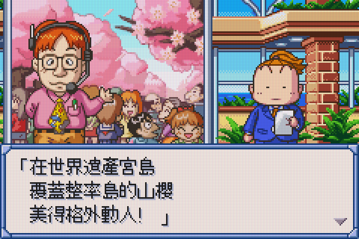
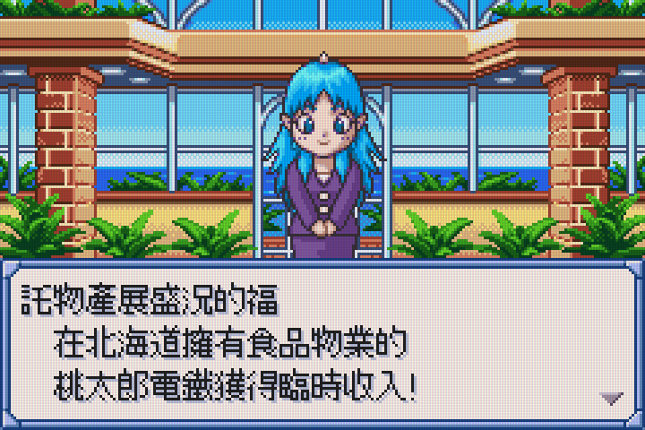
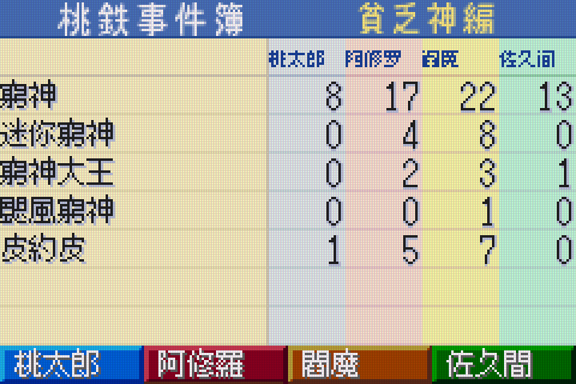
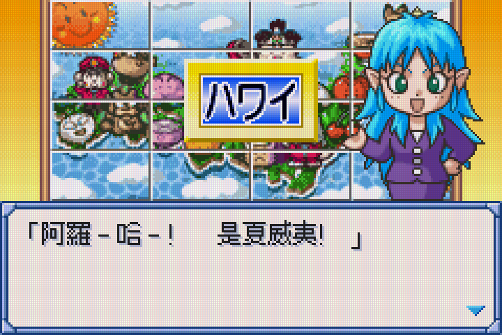

# Momotaro Dentetsu G: Experimental Traditional Chinese Build

<p align="center">
  
</p>

## Screenshots

<p align="center">
  
  
</p>
<p align="center">
  
  
</p>

## Public Repository Contents

This repository publishes conversion tools, reviewed mapping data, graphics
replacement metadata, and replay scenarios. It does not distribute game ROMs,
ROM archives, BIOS files, saves, fonts, or generated build artifacts. Supply
your own legally obtained source ROM and the required fonts before rebuilding.
See [the Silver attribution notes](assets/Silver-ATTRIBUTION.md) for its source.

Links below to ROMs, IPS patches, build reports, screenshots, and other analysis
artifacts describe the local development workspace; those files are not included
in this public repository. Tests require the local inputs and rebuilt artifacts
described below and will not pass on a source-only checkout.

This is a working conversion prototype, **not a verified complete-ROM translation**.
Both original ROMs are unchanged. Generated ROMs, IPS patches, and change reports
are under `build/`.

## Stable Testing Filename

Open [build/Momotarō Dentetsu.gba](build/Momotarō%20Dentetsu.gba) in mGBA for testing.
The matching [IPS patch](build/Momotarō%20Dentetsu.ips) and
[change report](build/Momotarō%20Dentetsu.json) use the same stable basename.
Use the file in `build/`, not the same-named original ROM in `assets/`.
The previous static basename is no longer refreshed; existing files are retained.
These are regular copies, currently identical to v34; numbered builds remain
available as archives. Refresh these three files after validating each new
build, then reload the ROM in mGBA. Do not overwrite or delete save files when
publishing an update. Existing saves under a previous ROM name may need to be imported once
when switching to the stable filename.

## mGBA Cheats

The [RetroArch cheat file](assets/cheats/Momotaro%20Dentetsu%20%28Traditional%20Chinese%29.cht)
contains nine independent, disabled-by-default toggles. The first eight were
checked with v24 and v26-v30; all nine are checked with v32-v34:

| Toggle | Effect | Memory write |
| --- | --- | --- |
| P1 money | Set cash to 999億9990萬 | `02010150:000F423F` |
| P1 極好的卡 | Replace utility-card slot 1 with card ID `50` | `02010170:00000050` |
| P1 滾開卡 (送神) | Replace utility-card slot 2 with card ID `4E` | `02010174:0000004E` |
| P1 疫苗卡 | Replace utility-card slot 3 with card ID `42` | `02010178:00000042` |
| P2 money | Set cash to 100萬 | `02010240:0000000A` |
| P3 money | Set cash to 100萬 | `02010330:0000000A` |
| P4 money | Set cash to 100萬 | `02010420:0000000A` |
| P1 multi utility cards per turn | Return to the action menu after a utility card; consume it normally | Runtime ROM patch, mGBA/v24, v26-v30, or v32-v34 |
| P1 驅魔卡 | Replace utility-card slot 4 with card ID `3C` | `0201017C:0000003C` |

The table shows the underlying memory writes, not codes to paste into
RetroArch. The seven original RAM toggles and the ninth toggle use two
CodeBreaker 16-bit writes each:
for example, money is `82010150 423F+82010152 000F`.
Cash uses units of 10萬, so 100萬 is raw value 10 (`0000000A`), not 100.
P2, P3, and P4 likewise refer to the actual turn order.
The new 驅魔卡 code is `8201017C 003C+8201017E 0000`; its list label is
`P1 Qu Mo Ka`. It removes 小惡魔 and 惡魔, not the poverty god.

Use the mGBA core and **Load Cheat File (Replace)** from RetroArch's Cheats menu.
Enable only
after loading a game and reaching the board, then apply and disable the toggles.
Back up your save first. Money and inserted cards remain after disabling;
disabling does not restore the previous balance or overwritten cards.
All card writes clear the replaced slot's auxiliary metadata. Disable card
cheats before using, discarding, buying, or rearranging cards.
Keep earlier utility-card slots populated when using the slot 2, 3, or 4
toggles; the inventory menu stops at an empty slot. If starting with no utility
cards, apply all four card toggles before opening the utility-card menu.

Keep the eighth toggle enabled to let P1 use successive utility cards in the
same turn, then choose dice to finish the turn normally. Movement cards still
end the turn; P2/P3/P4 and cancellation/special result codes are unchanged.
Card-insertion toggles must remain disabled while playing. This is not an
infinite-inventory cheat: card effects and consumption still happen normally.

The eighth toggle uses 22 raw GameShark ROM halfword patches, not RAM writes.
It redirects the card-dispatch epilogue at `0803720E` to unused ROM padding at
`08FFFF80`. Only result `8`, actor `0`, and utility inventory indices `5..12`
are changed to result `0`; the original stack/register epilogue is preserved.
Use only with the tested v24/v26-v30/v32-v34 ROMs and mGBA core. The ROM file is not modified.
**Fully close and relaunch the game to reliably turn this off.** Direct mGBA
set-disable restores the original bytes, but clearing/replacing the cheat list
can leave already-applied patches in the running core. Do not rely on merely
unchecking the item or clearing the list, and do not change it during card
animations. Reload the file after relaunch if necessary; avoid old save states.

**P1 means the first player in the actual turn order**, as explicitly requested
for the user's new game. These cheats do not automatically follow the human
player after a different setup or shuffle. 滾開卡 transfers the poverty god
to another player when used; it does
not remove every god or provide permanent protection.

The money write and card IDs were checked with the local v13 ROM in headless
mGBA, including the in-game balance, utility-card names and descriptions.
The CodeBreaker file is additionally checked through the libretro code
normalization path, rather than only the desktop cheat-file parser.
The three additional money toggles were checked against v14 RAM through the
same normalization path, including clearing the upper halfword and preserving P1.
The eighth toggle was checked through libretro normalization and 1,664 real ARM
execution cases covering all four players, all thirteen inventory slots, result
codes 0..15, both disabled/enabled states, and stack/callee-saved registers.
A headless gameplay replay used P1's vaccine and 極好的卡 in one April turn,
consumed both, returned to the menu, then rolled dice, moved, completed the
station/event prompts, and advanced to P2. A separate P2 card-use replay with
the toggle enabled still ended P2's turn normally.
The ninth toggle is checked against v32-v34's card table and 驅魔卡 name,
with real mGBA cheat application verifying slot 4, cleared metadata,
unchanged neighboring/P2 slots, and disabled-state behavior. All 1,664
multi-card execution cases still pass with the nine-entry file.
The physical handheld still needs user testing.

To repeat the focused machine-code tests with the Homebrew mGBA development
library (adjust paths for your installation; set `DYLD_LIBRARY_PATH` if your
local mGBA build has unlinked runtime dependencies):

```sh
cc -O2 -std=c11 -Wall -Wextra -Werror \
  -I/opt/homebrew/include tools/check_multicard_cheat.c \
  -L/opt/homebrew/lib -Wl,-rpath,/opt/homebrew/lib -lmgba \
  -o /tmp/check_multicard_cheat
/tmp/check_multicard_cheat 'build/Momotarō Dentetsu.gba' \
  'assets/cheats/Momotaro Dentetsu (Traditional Chinese).cht'
cc -O2 -std=c11 -Wall -Wextra -Werror \
  -I/opt/homebrew/include tools/check_deck_name.c \
  -L/opt/homebrew/lib -Wl,-rpath,/opt/homebrew/lib -lmgba \
  -o /tmp/check_deck_name
/tmp/check_deck_name 'build/Momotarō Dentetsu.gba'
```

## Silver Font Test

- [Silver test ROM](build/momotetsu-zh-Hant.silver-test.gba)
- [Silver IPS patch](build/momotetsu-zh-Hant.silver-test.ips)
- [Screenshots](analysis/preview-silver.png)
- [Previous font versus Silver](analysis/font-comparison-silver.png)
- [Verification report](analysis/verification-silver.json)
- [Local Silver font](assets/Silver.ttf) and [attribution](assets/Silver-ATTRIBUTION.md)

This rendering, now approved for v5, redraws **all 3,269 mapped font slots**, not just characters
that change during Traditional Chinese conversion. Unchanged Chinese, kana,
Latin letters, digits, spaces, and punctuation use the same font path. Silver
is rendered at its native 19-point grid into the existing 12x16 cells, retaining
punctuation's vertical placement. The seven traced graphic labels use Silver too.

As approved for this test, **51 distinct characters use Heiti TC fallback**:
49 missing from Silver and two whose actual ink exceeds the cell width. Each
fallback and its reason is listed in the build JSON. In that prototype, the three
unidentified used glyph codes remain original, as do untraced graphical text assets.
This is not a claim that every decorative bitmap in the game has been restyled.

Replacing all mapped glyphs also exposes more unverified OCR readings than v4:
3,060 slot replacements rely on OCR. This is a visual test build, not a completed
glyph-identification audit. Original ROMs and earlier builds are unchanged.

Rebuild to a new output path:

```sh
python3 tools/build_traditional.py assets/Momotar*.gba build/silver-rebuilt.gba \
  --map analysis/font-map-consolidated.json \
  --map analysis/original-font/vision-map.json \
  --review analysis/original-font/review.json \
  --review analysis/font-audit-01.json \
  --font assets/Silver.ttf --font-size 19 --baseline-y 1 \
  --fallback-font '/System/Library/Fonts/STHeiti Medium.ttc' \
  --replace-all --allow-ocr \
  --graphics analysis/menu-graphics-oam/label-locations.json \
  --graphics analysis/mode-graphics-source/label-locations.json \
  --graphics analysis/title-graphics-source/subtitle-locations.json
```

The Silver prototype passed the original ten tests, including complete
mapped-slot coverage, punctuation placement, fallback equality, and the IPS
round trip. The current suite additionally requires the v6 opponent graphics;
the prototype and v5 are expected to fail that new coverage check.

The Silver ROM also completed the recorded 12,908-frame mGBA scenario through
an opening board turn, with diagnostic counts and captured messages matching
the source baseline described below.

## Current Build

- [Experimental v34 ROM](build/momotetsu-zh-Hant.experimental-v34.gba)
- [Experimental v34 IPS patch](build/momotetsu-zh-Hant.experimental-v34.ips)
- [Exact change report](build/momotetsu-zh-Hant.experimental-v34.json)
- [Verification report](analysis/verification-v34.json)
- [Deck setup screen](analysis/emulator-v34-deck.png)
- [Quotation renderer check](analysis/emulator-v34-quotes.png)
- [Noodle renderer check](analysis/emulator-v34-noodles.png)

V34 includes the pending screenshot corrections and the follow-up 面 audit:

- Corrects `3D01` 肮, misread as 航, to render 骯髒手段. Genuine 航
  (`042B`, nine text occurrences) is unchanged.
- Restores all 17 pairs of 『』 (`0493`/`0494`) in titles and nested quotations.
  Ordinary 「」 retain their separate original codes.
- Displays the built-in おまかせ deck name, previously rendered お赤かせ,
  as 系統推薦. The shared seven-byte deck-name decoder recognizes only the
  exact default-name sequence; all other names use the original decoder.
  Player names use a separate path. Stored deck bytes, the name-entry character
  table, card contents, and save format are unchanged. The guarded eight-byte
  hook at `0B8AE8` uses a 76-byte routine at `FFFF00`, clear of the multi-card
  cheat reserve at `FFFF80`; both writes are listed in `runtime_text_patches`.
- Audits all 151 occurrences of source 面 across 147 identified records.
  Nine missed food uses now read 麵, including 麵與湯, 捲曲麵, 加麵(替玉),
  冬粉麵, and 長崎強棒麵. All food variants 麪/麺 are standardized to the
  user-selected 麵. The result has 75 food 麵 and 76 unchanged non-food 面,
  including 畫面, 路面, 見面, 面子, and the name 貧面魚.

All 44 translation tests pass, including actual output words and font bytes
for every audited 面 occurrence. The deck-name routine passes 18,432 actual
ARM cases covering default/custom names, all byte values, alignment, output
bounds, input preservation, stack, and callee-saved registers. All nine cheats
and 1,664 multi-card ARM cases pass as well.

The normal 8,956-frame deck setup replay reaches 系統推薦; its 12 pre-existing
game-error messages match v32, with no fatal or other errors. Both game-mode
quote pairs and 加麵/拉麵 were also rendered to completion in the game's animated
dialogue engine with no invalid glyphs or emulator diagnostics. Those two
dialogue checks inject text into the renderer, not the original gameplay events.
This does not claim complete-game coverage. Fully close and relaunch after
updating; use the normal in-game save rather than an old save state.

Installed on RG34XX with verified backups of v30, both saves, and both cheat
files. The `.sav` and `.srm` files are byte-identical before and after deployment.
Both the mGBA auto-load and `0QuickLoad` cheat files now contain nine entries;
all previous properties are preserved, including the auto-load file's eight
enabled toggles. The new 驅魔卡 toggle is disabled. The installed ROM and
quick-load cheat file also pass the nine-entry/1,664-case checker. Disable
card-insertion toggles before using or rearranging cards. Physical gameplay
verification remains for the user after relaunch.

### Previous v33 Test Build (Not Installed)

[V33](build/momotetsu-zh-Hant.experimental-v33.gba) contains the dirty-tactics,
quotation, and default-deck-name corrections above, before the follow-up 面
audit. Its 43 translation tests and machine-code checks passed. V34 supersedes
this local candidate.

### Previous v32 Build

- [Experimental v32 ROM](build/momotetsu-zh-Hant.experimental-v32.gba)
- [Experimental v32 IPS patch](build/momotetsu-zh-Hant.experimental-v32.ips)
- [Exact change report](build/momotetsu-zh-Hant.experimental-v32.json)
- [Verification report](analysis/verification-v32.json)
- [Settings screen](analysis/emulator-v32-settings.png)
- [Event-title and glyph comparison](analysis/v32-banner-and-selection.png)

V32 addresses the submitted screenshot batch:

- Corrects OCR readings `067D` 迎 -> 副, `3B9D` 宾 -> 寞,
  `38C6` 唱 -> 虑, and `39D5` 慨 -> 恢. The affected text now reads
  一副寂寞的樣子, 考慮, and 恢復. Genuine 迎 (`067C`) is unchanged.
- Keeps 游 in swimming contexts: 游泳, 游動, 游海, 游4-5公里,
  and 悠游水中. 遊戲, 周遊, 旅遊, 遊船, 遊客, 遊行, and 遊玩
  still use 遊. The source typo 没游 in the card-purchase message becomes 沒有.
- Redraws 選 with separated 巳 components; its original 选 reading was correct.
- Fixes two Thumb immediates at `089C7C` and `089C96`: the settings screen
  copied speed labels using obsolete Japanese string offsets. Normal and fast
  now start at byte offsets 4 and 10, not 8 and 16. This prevents blank labels,
  stray Japanese, and text spilling over 列車. The three speed choices, stored
  settings, and game behavior are unchanged. These two code writes are
  checksum-guarded and recorded separately as `code_fixes`.
- Replaces the reported blue-and-yellow イベント編 graphic with 事件篇,
  using two guarded tile spans and its original palette. Other untraced
  graphic headings are not claimed to be translated.

All 40 translation tests pass, including all 162 identified records containing
游/遊, exact decoded screenshot dialogue, graphics writes, and IPS reconstruction.
Executing the actual speed-copy instructions in mGBA passes for v32 and reproduces
the bad normal/fast reads in v31. A normal menu replay also reaches the corrected
settings screen with no emulator diagnostics. The event title is verified from
ROM tiles; a full gameplay visit to that statistics page remains pending.
Fully close and relaunch the game after updating; do not resume an old save state.

### Previous v31 Build

- [Experimental v31 ROM](build/momotetsu-zh-Hant.experimental-v31.gba)
- [Experimental v31 IPS patch](build/momotetsu-zh-Hant.experimental-v31.ips)
- [Exact change report](build/momotetsu-zh-Hant.experimental-v31.json)

V31 corrects 蘿卜 to 蘿蔔 in all five radish records: three property names
and two dialogue variants. The source mapping reads the second character as
katakana ト; a phrase override corrects 萝ト without changing standalone ト,
卜卦, or 菠蘿. Already-traditional 蘿卜 is also normalized to 蘿蔔.
All 36 translation tests pass, including decoded ROM text at all five locations
and the rendered 蔔 glyph. In-game visual review remains pending.
Fully close and relaunch the game after updating.

### Previous v30 Build

- [Experimental v30 ROM](build/momotetsu-zh-Hant.experimental-v30.gba)
- [Experimental v30 IPS patch](build/momotetsu-zh-Hant.experimental-v30.ips)
- [Exact change report](build/momotetsu-zh-Hant.experimental-v30.json)
- [Verification report](analysis/verification-v30.json)

V30 corrects 箱 (`0364`), misidentified as 稍, in 千兩箱卡,
千兩箱, 箱子 and related text. Genuine 稍 (`3943`) in 稍等 and 稍候
is preserved. The original bitmap confirms 竹 over 相.
Only 43 bytes in the 箱 glyph differ from v29; all other bytes are identical.
All 35 translation tests and 1,664 multi-card execution cases pass.
The 千兩箱 dialogue draws 17 valid glyphs with no invalid draws or emulator errors.
Installed on RG34XX with a verified v29 backup; save and eight cheats unchanged.
Fully close and relaunch the game after updating.

### Previous v29 Build

- [Experimental v29 ROM](build/momotetsu-zh-Hant.experimental-v29.gba)
- [Experimental v29 IPS patch](build/momotetsu-zh-Hant.experimental-v29.ips)
- [Exact change report](build/momotetsu-zh-Hant.experimental-v29.json)
- [Verification report](analysis/verification-v29.json)

V29 narrows the right component of 姬 by one pixel so its foreground no longer
touches the following 路 in 姬路. The v26 shorter height and left 女 component
are preserved. The exact 「姬路！」 dialogue draws five valid glyphs with
zero invalid draws or emulator errors. All 34 translation tests and 1,664
multi-card cheat execution cases pass.

Installed on the RG34XX after backing up v26; the save and all eight cheats
are byte-identical before and after deployment. V27 and v28 were local test
builds, not installed separately. Relative to v26, only 107 bytes differ:
42 in 嘛, 57 in 座, and eight in 姬; all other ROM bytes are identical.
Fully close and relaunch the game to load the new ROM.

### Previous v28 Test Build (Not Installed)

- [Experimental v28 ROM](build/momotetsu-zh-Hant.experimental-v28.gba)
- [Experimental v28 IPS patch](build/momotetsu-zh-Hant.experimental-v28.ips)
- [Exact change report](build/momotetsu-zh-Hant.experimental-v28.json)

V28 corrects 座 (`0640`), misidentified as 率, in all 19 occurrences:
整座島, 整座城鎮, 每座水族館, 這座都市 and related counters.
All 42 genuine 率 (`038D`) occurrences remain unchanged, including 收益率,
概率 and 效率. The exact 宮島 screenshot dialogue draws 26 valid glyphs
with zero invalid draws or emulator errors in the animated renderer.
All 34 translation tests and 1,664 multi-card cheat execution cases pass.
This includes the pending v27 嘛 correction; v27 could not be installed
while the handheld share was disconnected. Relative to installed v26,
only 99 bytes differ: 42 in 嘛 and 57 in 座. All other ROM bytes are identical.
Fully close and relaunch after updating; preserve saves and all eight cheats.

### Previous v27 Test Build (Not Installed)

- [Experimental v27 ROM](build/momotetsu-zh-Hant.experimental-v27.gba)
- [Experimental v27 IPS patch](build/momotetsu-zh-Hant.experimental-v27.ips)
- [Exact change report](build/momotetsu-zh-Hant.experimental-v27.json)

V27 corrects the original 嘛 glyph (`38E9`), previously misidentified as 麻.
All 19 dialogue occurrences now use 嘛, including 就是嘛 and 幹嘛.
Genuine 麻 (`056B`) remains unchanged in 麻煩, 麻雀, 麻糬 and names.
All 40 original 干 occurrences were individually audited against the emitted
ROM: their existing 幹/乾 conversions were already correct, including 幹嘛,
能幹, 幹勁, 新幹線, 乾脆, 乾淨, 餅乾 and 一夜乾. No global 干 replacement
was added; tests also preserve 干涉/干擾/干預.

All 33 translation tests and 1,664 multi-card cheat execution cases pass.
Actual animated 幹嘛 and sentence-final 嘛 samples draw 17 and 19 valid
glyphs respectively, with zero invalid draws or emulator errors.
Only 42 bytes in glyph `38E9` differ from v26; all other ROM bytes are
identical. Fully close and relaunch after updating; preserve saves and cheats.

### Previous v26 Build

- [Experimental v26 ROM](build/momotetsu-zh-Hant.experimental-v26.gba)
- [Experimental v26 IPS patch](build/momotetsu-zh-Hant.experimental-v26.ips)
- [Exact change report](build/momotetsu-zh-Hant.experimental-v26.json)
- [Verification report](analysis/verification-v26.json)

V26 corrects the separate **red** narrow currency font to 億/萬/元.
The red font uses palette indices 4/5/6 rather than the black font's 1/2/3;
all six currency slots are now covered. Red digits, minus, 兆, and the already
corrected black font are unchanged. A real negative-cash gameplay replay
now displays red `-4000萬元` instead of `-4000万`.

The right component of 姬 is shortened from 13 to 11 foreground rows, inset
one row at both top and bottom. The left 女 and the correct closed middle box
with upper/lower connections are preserved. The reported 決算發表 dialogue
draws 13 valid glyphs with zero invalid draws in the animated renderer.
All 31 translation tests and 1,664 multi-card cheat execution cases pass.
Exactly 151 bytes differ from v24: 134 in the three red currency slots and
17 in 姬; all other ROM bytes are identical. V25 was an uninstalled
currency-only test candidate. Fully close and relaunch after updating;
preserve saves and all eight cheats.

### Previous v24 Build

- [Experimental v24 ROM](build/momotetsu-zh-Hant.experimental-v24.gba)
- [Experimental v24 IPS patch](build/momotetsu-zh-Hant.experimental-v24.ips)
- [Exact change report](build/momotetsu-zh-Hant.experimental-v24.json)
- [Verification report](analysis/verification-v24.json)

V24 uses **隻** for creature counts, including 1隻, 3隻, 13隻, 幾隻 and
counts supplied by runtime text arguments. All 24 classifier occurrences are
checked against the ROM; adverb uses of 只 remain unchanged. An existing
OpenCC misconversion of 只有 in 說不定是只有當地人 is also corrected.
All 30 tests pass, covering all 436 contextual references and their glyph bytes.
The injected 有1隻 dialogue draws 16 valid glyphs in the real animated renderer
with unchanged baseline diagnostics. Exactly 1,408 bytes differ from v22,
confined to contextual allocations and references; normal fonts, currency
and graphical labels are unchanged. V23 was an uninstalled test candidate.
Fully close and relaunch after updating; preserve saves and cheats.

### Previous v22 Build

- [Experimental v22 ROM](build/momotetsu-zh-Hant.experimental-v22.gba)
- [Experimental v22 IPS patch](build/momotetsu-zh-Hant.experimental-v22.ips)
- [Exact change report](build/momotetsu-zh-Hant.experimental-v22.json)
- [Verification report](analysis/verification-v22.json)

V22 fixes the incorrect hand-drawn **姬** right component. The earlier redraw
resembled 臣 (as in 姫); the corrected component has a closed middle box with
vertical connections above and below, matching 姬. The left 女 and 13-row height
are unchanged. See the [pixel comparison](analysis/original-font/ji-v22-comparison.png).
All 29 tests pass, including explicit component-stroke checks.
Exactly 16 bytes in glyph `38A5` differ from v21; every other ROM byte is identical.
The reported 決算發表 / 由夜叉姬宣布 dialogue was injected into the real animated
renderer: 13 valid glyphs and unchanged baseline diagnostics.
Fully close and relaunch after updating; handheld appearance still needs confirmation.

### Previous v21 Build

- [Experimental v21 ROM](build/momotetsu-zh-Hant.experimental-v21.gba)
- [Experimental v21 IPS patch](build/momotetsu-zh-Hant.experimental-v21.ips)
- [Exact change report](build/momotetsu-zh-Hant.experimental-v21.json)
- [Verification report](analysis/verification-v21.json)

V21 corrects **克股 → 克服** by reviewing source glyph `0541` as 服 rather
than 股. Its 22 occurrences also restore 舒服, 服務, 說服, 佩服 and 征服.
The 11 genuine 股 occurrences at `3A94`, including 股票 and 一股, are preserved.
The existing contextual converter now also preserves 征 in 征服 instead of
using its standalone 徵 conversion. All 29 tests pass, including all 414
contextual glyph references. The actual animated renderer draws the 克服
dialogue with 25 valid glyphs and unchanged baseline diagnostics.
Only 252 ROM bytes differ from v20, confined to the corrected 服 glyph and
the contextual 征 allocation/reference. Fully close and relaunch after updating.

### Previous v20 Build

- [Experimental v20 ROM](build/momotetsu-zh-Hant.experimental-v20.gba)
- [Experimental v20 IPS patch](build/momotetsu-zh-Hant.experimental-v20.ips)
- [Exact change report](build/momotetsu-zh-Hant.experimental-v20.json)
- [Verification report](analysis/verification-v20.json)

V20 corrects the original-font OCR readings **著 → 薯** (five potato/sweet-potato
occurrences) and **间 → 问 → 問** (13 occurrences, including 問題, 請問, 詢問 and
顧問). Genuine 間 and 著 remain unchanged. The contextual food spelling
**面片 → 麵片** changes 麵片火鍋店 without altering face/surface uses of 面 or 素麪.
See the [source/candidate bitmap evidence](analysis/original-font/screenshot-batch-3-review.png);
the lower row there is the pre-fix v19.

All 28 regression tests pass, including all 413 contextual references and their
rendered glyph bytes. The additional contextual glyph shifts later allocated
slots; all references are rebuilt together. The complete ROM differs from v19
in 1,538 bytes. Currency glyphs and graphical labels are unchanged.
Injected 馬鈴薯田, 麵片火鍋店 and 問題 samples use the real mGBA animated renderer,
with zero invalid glyph draws and unchanged baseline diagnostics.

The submitted black balance screenshot exactly matches the corrected narrow
億/萬/元 bitmaps. The red balance screenshot instead matches the source 万/円
bitmaps. This confirms different glyph versions in the screenshots, not a
second unpatched font; the runtime cause is not proven. Fully close and relaunch,
then use the normal in-game save rather than restoring an older emulator state.
Handheld appearance still needs confirmation. Preserve existing saves and cheats.

### Previous v19 Build

- [Experimental v19 ROM](build/momotetsu-zh-Hant.experimental-v19.gba)
- [Experimental v19 IPS patch](build/momotetsu-zh-Hant.experimental-v19.ips)
- [Exact change report](build/momotetsu-zh-Hant.experimental-v19.json)
- [Verification report](analysis/verification-v19.json)

V19 makes **糰** slightly taller, from 14 to 15 foreground rows, while retaining
v18's open interior and the existing 12-pixel cell width. All five dango property
names share this update. See the [comparison](analysis/original-font/dango-v19-comparison.png).
All 26 tests pass, including the exact height and interior-whitespace checks.
Only 11 bytes in glyph `3D9C` differ from v18; all other ROM bytes are identical.
An injected 醬油糰子店 sample uses the real mGBA animated renderer and draws
five valid glyphs with unchanged baseline diagnostics.
Fully close and relaunch after installation; handheld appearance still needs
confirmation. Saves and cheats must be preserved.

### Previous v18 Build

- [Experimental v18 ROM](build/momotetsu-zh-Hant.experimental-v18.gba)
- [Experimental v18 IPS patch](build/momotetsu-zh-Hant.experimental-v18.ips)
- [Exact change report](build/momotetsu-zh-Hant.experimental-v18.json)
- [Verification report](analysis/verification-v18.json)

V18 opens the cramped interior of **糰** without reducing its 14-row height.
The [bitmap comparison](analysis/original-font/dango-v18-comparison.png) shows
the extra white space inside 囗 and between the compressed 專 strokes.
All five identified dango property names share the contextual `3D9C` slot:
竹糰子店, 醬油糰子店, 黍糰子店, 少爺糰子店, and 糰子湯店.
The ordinary 團 glyph remains unchanged.
All 26 regression tests pass, including explicit interior-whitespace and
shared-property-slot checks. Exactly 19 bytes in that single 96-byte glyph
slot differ from v17; every other ROM byte is identical.
An injected 醬油糰子店 sample in the actual animated mGBA renderer draws five
valid glyphs, with zero invalid glyph draws and unchanged baseline diagnostics.
Physical handheld appearance still needs confirmation.
Fully close and relaunch after installation; preserve existing saves.

### Previous v17 Build

- [Experimental v17 ROM](build/momotetsu-zh-Hant.experimental-v17.gba)
- [Experimental v17 IPS patch](build/momotetsu-zh-Hant.experimental-v17.ips)
- [Exact change report](build/momotetsu-zh-Hant.experimental-v17.json)
- [Verification report](analysis/verification-v17.json)

V17 addresses the second screenshot batch:

| Report | Verified correction |
| --- | --- |
| 亿 and 万丹 / 万䍏 in numeric displays | Replace the separate 8x16 currency glyphs 亿、万、円 with 億、萬、元, preserving numeric layout |
| 「護掉吧」 | `3830` is 扔, not 护; fix 18 identified occurrences without changing genuine 護 |
| 倉敖卡 | `02AF` is 敷, not 敖; fix 倉敷卡 and the four city-name occurrences |
| 「童無意義」 | `39FA` is 毫, not 童; fix 32 occurrences while retaining genuine 童 |
| 涮 | Mapping is correct; replace the missing-font fallback with a 14-row pixel redraw |
| 䴉 | Mapping is correct; replace the small fallback with a 14-row Traditional glyph redraw |
| 一夜乾 | Use the contextual spelling 一夜乾魷魚店 at both property-name records; do not globally change 幹 |
| 素麪 | Use the requested 麪 spelling in all six 素面 contexts; retain 面 in unrelated words |

The currency units are unconverted bitmap assets, not the ordinary 12x16 text
font. Their source foreground masks match the submitted price screenshot.
The three original 64-byte slots at `E43A94`, `E43AD4`, and `E43B14` are
checksum-checked before replacement. Digits, signs, 兆, spacing, and palettes
are unchanged. See the [currency bitmap comparison](analysis/original-font/currency-v17-comparison.png).

All 25 regression tests pass. Exactly 413 bytes differ from v16: 259 bytes
across five ordinary font slots, 138 bytes across three narrow currency slots,
and 16 bytes in eight contextual text words. No executable code, other assets,
allocated-glyph assignments, or previous fixes change.
The [ordinary glyph comparison](analysis/original-font/screenshot-batch-2-v17-comparison.png)
and [seven injected mGBA text samples](analysis/emulator-v17-screenshot-review.png)
check the new readings and redraws. The injected text tests use the actual
animated renderer, not natural replays of every submitted scene. The narrow
currency assets are validated by their ROM bytes and screenshot-mask match;
their original property-list screens still need handheld confirmation.
The older 「一件都賣不了！」 screenshot is covered by the retained v16 repair.
Fully close and relaunch the game after installing; preserve existing saves.

### Previous v16 Build

- [Experimental v16 ROM](build/momotetsu-zh-Hant.experimental-v16.gba)
- [Experimental v16 IPS patch](build/momotetsu-zh-Hant.experimental-v16.ips)
- [Exact change report](build/momotetsu-zh-Hant.experimental-v16.json)
- [Verification report](analysis/verification-v16.json)

V16 addresses the eight submitted screenshots:

| Report | Verified correction |
| --- | --- |
| Character before 湧 | `3CDC` is 汹, not 沤; the city description now reads 洶湧 |
| Small 啊 | A 14-row pixel redraw replaces the undersized fallback |
| Colored garbage after 「一件都賣不了！」 | Add the missing final `8000` newline using one spare `FFFF` word; retain the next terminator |
| Solid interior of 姬 | Redraw with open spaces in the right component |
| Incorrect 慢 in speed settings | `0557` is 慢, not OCR candidate 𠎠; fix all 38 identified occurrences |
| Small 糰 | A 14-row redraw replaces the fallback in the contextual 糰 slot |
| 金槍魚涵店 | Already corrected to 金槍魚湯店 by v14, retained in v16 |
| 博…鍋店 | `3B4D/3B4E` are 馎饦, not 博饪; Traditional output is 餺飥鍋店, with readable pixel redraws |

The raised long-vowel mark `390D` is also corrected from 一 to ー in 126
identified occurrences. Genuine 一 (`0061`) and 博 (`02B6`) remain unchanged.
Pixel redraws apply only to the existing Silver 19-point, baseline-y=1 profile.
See the [ROM glyph comparison](analysis/original-font/screenshot-batch-v16-comparison.png)
and [mGBA-rendered text samples](analysis/emulator-v16-screenshot-review.png).

All twenty-three regression tests pass. Relative to v15, exactly 406 bytes
change: eight font slots and the two-byte newline repair at `0xDE9830`.
All other ROM bytes, including executable code, context-rewrite addresses,
graphics, and cheat addresses, are identical. The newline repair is explicitly
declared in the build report's `text_control_fixes`; no global newline rewrite
or game-engine patch is applied.

The actual animated dialogue path was tested by injecting the reported text
index at its reader entry in headless mGBA. V15 draws 32 glyphs, including the
invalid `FFFF` terminator; v16 draws exactly the intended 20 and no invalid
glyph. Five further injected text samples check 啊, 姬, 洶湧, 餺飥, and 糰.
These use the real renderer, but are not natural replays of every submitted
scene. Existing baseline memory diagnostics remain unchanged.
Fully close and relaunch the game after installing; preserve existing saves.

### Previous v15 Build

- [Experimental v15 ROM](build/momotetsu-zh-Hant.experimental-v15.gba)
- [Experimental v15 IPS patch](build/momotetsu-zh-Hant.experimental-v15.ips)
- [Exact change report](build/momotetsu-zh-Hant.experimental-v15.json)
- [Verification report](analysis/verification-v15.json)

V15 improves **糬** without changing the spelling 麻糬. Silver lacks this
character; its previous 12-point fallback was difficult to read. A hand-drawn
12x16 bitmap keeps 米, 罒, and 者 distinct, with open counters in the lower 日.
The override applies only to the Silver 19-point, baseline-y=1 build profile,
and is recorded in the font report. All other font profiles retain their
existing rendering behavior.
The [before-and-after bitmap](analysis/original-font/mochi-redrawn.png) shows
the change. All twenty regression tests pass, including component geometry
and the 福福麻糬店 text. Exactly 58 bytes within glyph `3B1C` differ from v14;
all other ROM bytes are identical. This updates all eleven identified
occurrences of 糬 without changing text, saves, or cheat addresses.
No new gameplay replay was run. Fully close and relaunch after installing.

### Previous v14 Build

- [Experimental v14 ROM](build/momotetsu-zh-Hant.experimental-v14.gba)
- [Experimental v14 IPS patch](build/momotetsu-zh-Hant.experimental-v14.ips)
- [Exact change report](build/momotetsu-zh-Hant.experimental-v14.json)
- [Verification report](analysis/verification-v14.json)

V14 corrects glyph `3855`: the [original bitmap](analysis/original-font/3855-review.png)
shows **汤**, not the OCR reading 涵. Traditional output now renders **湯**
in all 35 occurrences across 33 identified text records, including
「全都泡湯了！」, 湯頭, 高湯, 湯布院, and 湯澤.
All nineteen regression tests pass. Exactly 48 bytes within this one 96-byte
font slot differ from v13; every other ROM byte is identical, preserving the
existing cheat addresses and card IDs. No new gameplay replay was run.
Fully close and relaunch the game after replacing the device ROM; an
already-running emulator retains the old ROM in memory. Do not overwrite
existing save files when installing the update.

### Previous v13 Build

- [Experimental v13 ROM](build/momotetsu-zh-Hant.experimental-v13.gba)
- [Experimental v13 IPS patch](build/momotetsu-zh-Hant.experimental-v13.ips)
- [Exact change report](build/momotetsu-zh-Hant.experimental-v13.json)
- [Verification report](analysis/verification-v13.json)

V13 corrects glyph `3866`: the original bitmap is **极**, not the OCR reading
板. Traditional output now renders **極** in all 44 occurrences in the
identified text region, including 極好的卡, 積極, and 極限. The
[original-versus-v12 bitmap](analysis/card-name-3866-review.png) and extracted
text contexts establish the corrected reading. This is a glyph-specific fix,
not a global substitution of 板. All eighteen regression tests pass.
Exactly 34 bytes within the one 96-byte font slot differ from v12;
all other ROM bytes, including text words and graphics, are unchanged.
No new gameplay replay was run. Restart the game after updating the device
ROM so an already-running emulator does not keep the older ROM in memory.
Existing save files are preserved.

### Previous v12 Build

- [Experimental v12 ROM](build/momotetsu-zh-Hant.experimental-v12.gba)
- [Experimental v12 IPS patch](build/momotetsu-zh-Hant.experimental-v12.ips)
- [Exact change report](build/momotetsu-zh-Hant.experimental-v12.json)
- [Verification report](analysis/verification-v12.json)
- [Corrected opponent screen](analysis/preview-v6-opponents.png)
- [All eight opponent selections](analysis/opponent-selection-v6-complete/all-selections.png)

V12 corrects the character name to **閻魔**: `001F` is 閻 and `0020` is 魔,
both user-confirmed. This supersedes the earlier tentative 閰 reading, which
was never published. The main font no longer renders these codes as 赤寬;
the opponent-menu graphics already used 閻魔 and remain unchanged. Silver
supports both characters, so no additional fallback or name override is needed.
All seventeen tests pass. Exactly 109 bytes within the two font slots differ
from v11; all other ROM bytes, including text words and graphics, are identical.

V11 incorporated four user-confirmed readings: `0289` is Japanese 渋, `028A` is
谷, `04EE` is 梅, and `067C` is 迎. The original reading 渋 is preserved in the
review; output normalizes it to 澀. This repairs 澀谷 and 谷底 without replacing
every 谷 with 穀. Three occurrences of 谷仓 become 穀倉 through OpenCC's phrase
conversion, using one additional contextual glyph.

There are now **zero unmapped used codes in the identified text region**. This
does not mean every mapping is correct or the entire ROM has been identified.
All seventeen tests pass on the archive and stable copy, and the recorded
12,908-frame gameplay replay matches source diagnostics. V10 was an unpublished
draft; the fixed testing filename moved directly from v9 to v11. All earlier
archives and save files are retained.

V9 corrected six more punctuation OCR errors: the double quote (`0006`), dollar
sign (`0008`), apostrophe (`000B`), asterisk (`000E`), plus (`000F`), and period
(`0012`). Their original bitmaps match the Japanese ROM; text contexts include
apostrophes in `Let'S`, arithmetic signs, and warning markers. The
[side-by-side audit](analysis/original-font/punctuation-audit-v8.png) preserves
the original-versus-v8 evidence. Exactly 171 bytes in those six font slots differ
from v8; all other ROM bytes are unchanged. Fifteen tests pass against both the
archive and stable testing copy, and the full recorded gameplay path was rerun.

V8 fixed the right parenthesis misidentified as `0` in station readings such as
`(ゆざわ)`. Original glyph `000D` is now verified as `)` using its
[original bitmap](analysis/original-font/parentheses-review.png), identical
Japanese glyph, and text contexts. The genuine zero at `0014` is unchanged.
Exactly 36 bytes within the one 96-byte glyph differ from v7; all other ROM
bytes are identical. The code occurs 64 times in the identified text region,
without implying that every occurrence is runtime-reachable. All fourteen tests
pass. The [previous v7 ROM](build/momotetsu-zh-Hant.experimental-v7.gba) is retained.

V7 applied the user's explicit **着 -> 著** preference after OpenCC conversion,
both for individual glyph defaults and context-sensitive spans. Slot `022E`
now renders 著 wherever used, including 135 occurrences in the identified text
region; that scan does not prove every occurrence is reachable during play.
Exactly 52 bytes within that one 96-byte glyph differ from v6. All other ROM
bytes are identical, including the opponent graphics. All thirteen tests pass.
The [previous v6 ROM](build/momotetsu-zh-Hant.experimental-v6.gba) is unchanged.

V6 fixed the Simplified Chinese opponent grid reported in v5. Those names were
separate sprites, not entries in the main dialogue font. Twelve checksum-guarded
sprite pieces now render all eight names in Silver: 豆鬼, 赤鬼, 馬鬼, 餓鬼,
風神, 阿修羅, 閻魔, and 佐久間. Selection palettes, stars, portraits, and frames
are preserved. The small three-character name uses a reduced size to fit its
original 32-pixel sprite. Japanese banner artwork remains unchanged.

V6 passed eleven tests, including a check that the opponent sprite replacements
actually appear in the output ROM. All eight distinct highlighted opponents
were exercised in mGBA, with pixel comparisons against v5 outside the names.
The full 12,908-frame gameplay scenario was also rerun for v6.

V6 retains the approved Silver body font and the same 51 Heiti TC fallback
characters. The previous [v5 ROM](build/momotetsu-zh-Hant.experimental-v5.gba)
and [v5 patch](build/momotetsu-zh-Hant.experimental-v5.ips) are unchanged.

The previous [v4 ROM](build/momotetsu-zh-Hant.experimental-v4.gba) and
[v4 IPS patch](build/momotetsu-zh-Hant.experimental-v4.ips) remain available.
V6 retains v4's [high-usage accuracy audit](analysis/font-audit-01.json), including
the corrected extracted reading of `0130` from 狗 to 的 in 2,649 occurrences.

Use the ROM directly in mGBA, or apply the IPS patch to the exact verified source
ROM below. Do not apply it to a different dump, the Japanese ROM, or a previous
build.

### Original ROM Information

| Property | Value |
| --- | --- |
| Platform | Nintendo Game Boy Advance |
| Game title | Momotaro Dentetsu G: Gold Deck o Tsukure! (`MOMOTETSU-G`) |
| Region / game code | Japan / `BM2J` |
| Maker code | `18` |
| Revision | `00` |
| ROM size | 16 MiB (16,777,216 bytes) |
| CRC32 | `36DE69CA` |
| MD5 | `5601c26d11553e1bb4b4fa050e59c920` |
| SHA-1 | `880db29bd20036bb7b3f058934f7b6cf119b9bdd` |
| SHA-256 | `073a385c1ba1bcd517e2cfea659e54d9e2a87cc3ea5f6f17fe0ba169083ec28f` |

The bundled reference archive
`Momotarou Dentetsu G - Gold Deck o Tsukure! (Japan).zip` contains a separate
16 MiB member dump:

| Property | Value |
| --- | --- |
| Member CRC32 | `5F3E184E` |
| Member MD5 | `80177651fac95135f205c00a5f8ae922` |
| Member SHA-1 | `acb39c3da3c93247e6c2fd7fbda7df2fc720cdd7` |
| Member SHA-256 | `f5853a1d314d9f534073fddf41bda7a4648ddf777860f3c309223bd45e563c86` |
| Archive SHA-256 | `c1f07f5d28b157a94790a0e15b0402cb058477b94ae298b02b0ee35be416cfec` |

The current build redraws 3,272 font slots, adjusts 461 context-dependent text
words, and adds 63 contextual glyphs in verified empty space. Seven embedded
graphic labels are converted: five main-menu entries, the three-year mode
label, and the title subtitle. V6 adds the eight opponent names, bringing the
total to 45 graphical pieces; v32 adds two pieces for the reported event heading.
Their original frames, palettes, dimensions,
and tile layouts are retained. Three separate 8x16 currency slots are also
converted in v17. The ROM remains 16 MiB.

## Important Limits

- **3,027 font replacements depend on unverified OCR readings.** The change report
  marks each replacement's source verification status. These need a glyph and
  language audit before a release can be called complete or reliable.
- The three previously unmapped used original-font codes are now user-confirmed.
  Seven unresolved added-font review entries have no occurrences in the
  identified text region and remain unchanged. Mapping all used codes in that
  region does not establish complete-ROM coverage or OCR accuracy.
- Two long terminator-delimited records and one trailing unterminated word are
  excluded from context-specific rewriting. Global font replacements still
  apply wherever the game draws those glyph codes.
- Only the seven earlier graphical labels, the eight opponent-grid names,
  the reported event-page heading, and the narrow currency units
  have been audited and converted. Other embedded graphics may still contain
  Simplified Chinese or Japanese, including the opponent-name banner artwork.
- OpenCC `s2t` plus the 着 -> 著, Japanese 渋 -> 澀, 一夜干 -> 一夜乾,
  and contextual food 麵 overrides is used for conversion. This is not a general Taiwan-specific localization,
  a retranslation of Japanese text, or a manual semantic review.
- The text extractor identifies terminator-delimited candidates and preserves
  control words. It does not establish every candidate's runtime reachability
  or prove that all ROM text lives in the identified region.

## Rebuild

The build used Python 3.14 on macOS. Install the packages from
[requirements.txt](requirements.txt) in an isolated environment. Avoid installing
the separate `OpenCC` distribution into the same environment: both packages
provide the `opencc` import, and the build uses `opencc-python-reimplemented`.

```sh
python3 -m venv .venv
.venv/bin/python -m pip install -r requirements.txt
.venv/bin/python tools/build_traditional.py assets/*.gba build/rebuilt.experimental.gba \
  --map analysis/font-map-consolidated.json \
  --map analysis/original-font/vision-map.json \
  --review analysis/original-font/review.json \
  --review analysis/font-audit-01.json \
  --font assets/Silver.ttf --font-size 19 --baseline-y 1 \
  --fallback-font '/System/Library/Fonts/STHeiti Medium.ttc' \
  --replace-all --allow-ocr \
  --graphics analysis/menu-graphics-oam/label-locations.json \
  --graphics analysis/mode-graphics-source/label-locations.json \
  --graphics analysis/title-graphics-source/subtitle-locations.json \
  --graphics analysis/opponent-graphics-source/label-locations.json \
  --graphics analysis/event-graphics-source/label-locations.json
```

The builder refuses existing output paths and validates the source ROM, font
slot checksums, and every graphics asset before writing. It creates a ROM,
an IPS patch relative to the original, and a JSON audit report. Omitting
`--allow-ocr` limits character conversion to confirmed mappings; it does not
produce a complete conversion.

After rebuilding to the new output path above, validate it and publish the
stable testing copies (the builder itself does not refresh them automatically):

```sh
TRANSLATION_CANDIDATE=build/rebuilt.experimental.gba \
  python3 -m unittest discover -s tools -p 'test_translation.py' -v &&
for extension in gba ips json; do
  cp "build/rebuilt.experimental.$extension" "build/Momotarō Dentetsu.$extension" || exit 1
done
```

The primary font is [Silver](assets/Silver.ttf); see its
[attribution and licensing notes](assets/Silver-ATTRIBUTION.md). The fallback is
macOS Heiti TC, collection face 0, which is not included in this repository.
The report records both fonts' paths and checksums. A different font may
change appearance or fail the glyph-coverage and size checks. Font licensing
and redistribution permissions are separate from this local build process.

## Text and Mapping Tools

- [Consolidation tool](tools/consolidate_font.py): merges the added-font OCR
  drafts with reviewed answers, preserving uncertainty and provenance.
- [Text extractor](tools/extract_text.py): exports original words, offsets,
  controls, confirmed text, and a separate OCR-based draft.
- [ROM builder](tools/build_traditional.py): changes glyphs and verified graphic
  assets, allocates contextual variants, and produces the ROM and IPS patch.

Example extraction to a new output file:

```sh
python3 tools/extract_text.py assets/*.gba analysis/text-with-original-reviews.json \
  --map analysis/font-map-consolidated.json \
  --map analysis/original-font/vision-map.json \
  --review analysis/original-font/review.json \
  --review analysis/font-audit-01.json
```

The verified font format is 12x16 pixels, 4bpp, row-major, low nibble first,
96 bytes per glyph, based at ROM offset `0xDF5298`. The identified text region
is `0xD91A40..0xDF5298` (end exclusive), using little-endian 16-bit words.
`FFFF` terminates a record; `8000` is a line break; `8100` inserts runtime text;
`8200`, `8300`, and `8400` change style. The extraction report records the
disassembly locations supporting those interpretations.

## Verification

Run all forty regression tests against the original ROMs and the stable
testing copy:

```sh
python3 -m unittest discover -s tools -p 'test_translation.py' -v
```

They check original checksums, review precedence, unresolved glyph handling,
text controls, glyph and sprite packing, stale-input rejection, IPS record
limits and round-trip reconstruction, and declared write boundaries.
They also check all-mapped-character coverage, Silver punctuation placement,
and fallback glyph equality. The opponent test verifies its unique source
matches, palette indices, Traditional targets, bounded writes, and output-ROM
bytes. `TRANSLATION_CANDIDATE` overrides the candidate, but older builds missing
these graphics or the 着 -> 著 policy are expected to fail the corresponding
new checks. The override tests cover both phrase conversion and output glyph
bytes, and reject 着 in converted defaults or contextual targets.
The parenthesis regression also checks `(ゆざわ)0` decoding and requires the
output ROM to render `000D` as `)`, so older builds fail that coverage check.
The punctuation regression verifies the six additional reviewed symbols.
The 極 regression checks the corrected `3866` reading, the 極好的卡 sentence,
all 44 source-word occurrences, and the output glyph bytes; stale 板 builds fail.
All-mapped-font coverage now checks each build-record source reading against
the current mapping, so a stale OCR-based artifact cannot pass merely because
its output bytes match its own outdated report.
The six recently user-confirmed glyphs are checked against the review and ROM bytes.
The suite also checks 澀谷/谷底 versus 穀倉 and the three actual context-word
rewrites, and requires zero unmapped used codes in the current build report.

The optional headless runner uses the installed mGBA library. On the tested
Apple Silicon Homebrew installation:

```sh
clang -std=c11 -Wall -Wextra -Werror -I/opt/homebrew/include tools/check_rom.c \
  -L/opt/homebrew/lib -Wl,-rpath,/opt/homebrew/lib -lmgba -o analysis/check_rom
analysis/check_rom 'build/Momotarō Dentetsu.gba' \
  analysis/new-smoke-run 700:0 2:8 120:0
```

Each input is `frames:key_mask`. GBA masks include A=1, B=2, Start=8,
Right=16, Left=32, Up=64, and Down=128. The runner captures each segment's
screen and the final video memory. It does not autoload or write host save
files; the initial in-game save runs in emulator memory.

The recorded [longer scenario](analysis/emulator-v2-gameplay/scenario.json)
runs 12,908 frames through boot, menus, player setup, initial saving,
introductions, and an opening board turn. Source, Silver, v6, v9, and v11 report zero
fatal and ordinary emulator errors and 108 game-level bad-memory messages;
the first ten captured messages match. The separate
[opponent-selection scenario](analysis/opponent-selection-v6-complete/scenario.json)
visits all eight distinct highlighted cells. Both v5 and v6 report zero fatal,
ordinary, and game-level errors on that scenario. This is a source-baseline
caveat, not a clean full-game certification. No physical GBA test or full
playthrough has been performed.

V7 has not had a separate emulator replay. Its thirteen artifact tests pass,
and comparison with v6 proves that only the 96-byte `022E` font slot differs;
all text/control words, graphics, and program bytes remain identical.
V8 likewise has no separate emulator replay: fourteen artifact tests pass,
and comparison with v7 proves that only the `000D` parenthesis font slot differs.
V9's fresh 12,908-frame replay includes the earlier fixes. Its tracked diagnostic
counts and first ten game-error messages match the source baseline. This does
not prove every corrected glyph was shown during that recorded path.
V11 also completed that replay with the same source-baseline results. Its binary
changes relative to v9 are restricted to the four confirmed base glyphs and
contextual text/glyph allocations; other graphics and program data are unchanged.
V12 has no separate emulator replay. Its seventeen artifact tests pass and the
binary comparison proves that only the two name glyphs differ from v11.

### mGBA BIOS Warning

The user reported mGBA 0.10.5 displaying "This game uses a BIOS call that is not
implemented" during saving, and that play continues after clicking OK. This
notice concerns BIOS-call emulation. Configure mGBA to use an official GBA BIOS
dumped from your own console for better compatibility, as the dialog recommends.

The headless runner counts only fatal, error, and game-error log levels; it does
not establish that BIOS warnings or stub messages are absent. This particular
notice has not been reproduced and compared against the source ROM here. Playing
after dismissing it also does not verify persistent saves: test saving and
reloading before relying on progress. No BIOS-call code was changed by this fix.